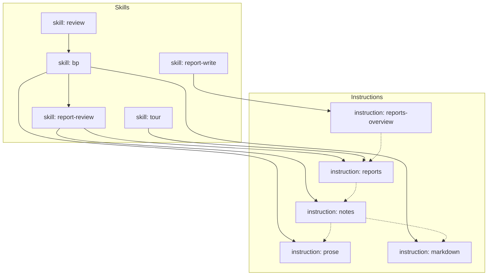

# Railing

Engineering guardrails that keep AI coding agents on track.

## VS Code first

The plugin follows the [Agent Plugins](https://agent-plugins.org) standard where it can, but other
vendors have not yet adopted the standard. Rules and agents live in `com.github.copilot/`,
the only directory VS Code reads them from, so the plugin is VS Code first. Skills are plain
`SKILL.md` files and travel to other agents more easily than rules do.

To install the railing plugin in VS Code, open this URL:

`vscode://chat-plugin/install?source=SavenkovIgor/railing&plugin=railing`

The URL installs the plugin and a marketplace that lists only this plugin. VS Code uses the
marketplace to update the plugin automatically.

## Contents

```text
├── plugin.json                                  plugin name, version, description, Agent Plugins schema
├── marketplace.json                             marketplace listing that lets VS Code install the plugin
├── com.github.copilot/                          the only directory where VS Code reads rules and agents
│   ├── agents/
│   │   ├── controller.agent.md                  owns the task, runs planner, coder, and reviewer
│   │   ├── planner.agent.md                     turns a brief into a plan
│   │   ├── coder.agent.md                       implements a plan
│   │   ├── reviewer.agent.md                    checks a change against its task
│   │   ├── researcher.agent.md                  experimental, researches a question and reports options
│   │   └── gilfoyle.agent.md                    blunt code review and analysis
│   └── rules/
│       ├── global.instructions.md               general agent behavior and workflow guidance
│       ├── issues.instructions.md               scope of one issue in any tracker
│       ├── code.instructions.md                 shared coding principles for C++, Python, JavaScript, TypeScript
│       ├── code-cpp.instructions.md             C++ coding style
│       ├── code-python.instructions.md          Python coding style
│       ├── markdown.instructions.md             formatting checks for all *.md files
│       ├── prose.instructions.md                how developer-facing prose reads, in all *.md files
│       ├── notes.instructions.md                path, task ID, and language of agent-written notes in notes/
│       ├── plans.instructions.md                how a plan in notes/ changes: in place, with no history
│       ├── reports.instructions.md              content requirements for reports about existing code in notes/
│       └── reports-overview.instructions.md     structure and checks for *.overview.md reports
└── skills/
    ├── bp/                                      validate files against best-practice references
    ├── debug-context-artifacts/                 inspect the initial AI context state
    ├── decision-flow/                           walk through open decisions in short rounds of questions
    ├── design-system/                           create or audit design systems
    ├── engineering-maturity/                    rank missing engineering practices by return on effort
    ├── migration-skill-factory/                 create skills for codebase migrations
    ├── poke/                                    reprimand for console abuse, redo the step by the rules
    ├── pr-comments/                             sort unanswered pull request comments, draft replies in the chat
    ├── project-glossary/                        merge tracker, docs, and code terms into GLOSSARY.md
    ├── reflect/                                 propose context improvements after a task
    ├── report-review/                           clean up a report and verify it against the code
    ├── report-write/                            write a technical report about existing code into notes/
    ├── review/                                  review a change against its intent, report only
    ├── to-issues/                               convert plans and discussions into tracker issues
    └── tour/                                    explain a codebase: one-page map, then a drill into one area
```

## File links

The diagram shows which rule and skill files depend on which. A solid arrow means "links to". A dashed arrow means that the `applyTo` scope of the file lies inside the scope of the target, so both attach together.


