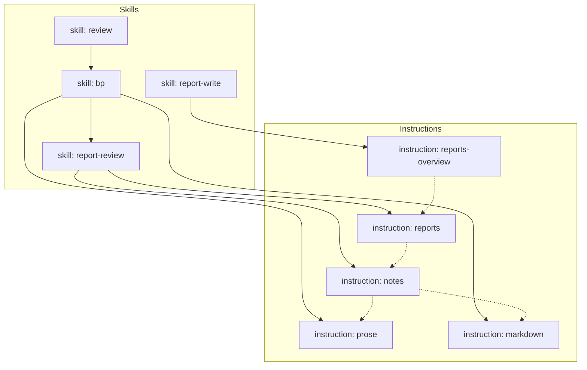

# Railing

Engineering guardrails that keep AI coding agents on track.

## VS Code first

The plugin follows the [Agent Plugins](https://agent-plugins.org) standard where it can, but the
standard is not yet adopted by other vendors. Rules and agents live in `com.github.copilot/`,
the only directory VS Code reads them from, so the plugin is VS Code first. Skills are plain
`SKILL.md` files and travel to other agents more easily than rules do.

To install railing plugin into VS Code use this link:

`vscode://chat-plugin/install?source=SavenkovIgor/railing&plugin=railing`

It will install both, plugin and marketplace (for autoupdate) with this plugin only

## Contents

```text
├── plugin.json                                  plugin name, version, description, Agent Plugins schema
├── marketplace.json                             marketplace listing that lets VS Code install the plugin
├── com.github.copilot/                          the only directory where VS Code reads rules and agents
│   ├── agents/
│   │   └── gilfoyle.agent.md                    blunt code review and analysis
│   └── rules/
│       ├── global.instructions.md               general agent behavior and workflow guidance
│       ├── global-code.instructions.md          shared coding principles for C++, Python, JavaScript, TypeScript
│       ├── api-cpp.instructions.md              C++ API development guidance
│       ├── api-python.instructions.md           Python API development guidance
│       ├── markdown.instructions.md             formatting checks for all *.md files
│       ├── prose.instructions.md                how developer-facing prose reads, in all *.md files
│       ├── notes.instructions.md                path, task ID, and language of agent-written notes in notes/
│       ├── reports.instructions.md              content requirements for reports about existing code in notes/
│       └── reports-overview.instructions.md     structure and checks for *.overview.md reports
└── skills/
    ├── bp/                                      validate files against best-practice references
    ├── debug-context-artifacts/                 inspect the initial AI context state
    ├── design-system/                           create or audit design systems
    ├── engineering-maturity/                    rank missing engineering practices by return on effort
    ├── migration-skill-factory/                 create skills for codebase migrations
    ├── reflect/                                 propose context improvements after a task
    ├── report-review/                           clean up a report and verify it against the code
    ├── report-write/                            write a technical report about existing code into notes/
    ├── review/                                  review a change against its intent, report only
    └── to-issues/                               convert plans and discussions into tracker issues
```

## File links

Which rule and skill files depend on which. A solid arrow means "links to". A dashed arrow means that the `applyTo` scope of the file lies inside the scope of the target, so both attach together.


